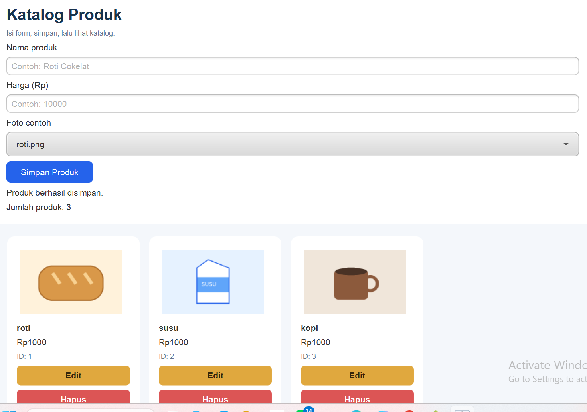

# Katalog Produk

Aplikasi Katalog Produk berbasis JavaFX yang dibuat menggunakan Apache NetBeans.

## Fitur
- Menambahkan produk
- Menampilkan katalog produk
- Mengedit data produk
- Menghapus produk
- Membatalkan proses edit
- Menampilkan informasi produk

## Teknologi
- Java
- JavaFX
- Maven
- SQLite
- Scene Builder

## Cara Menjalankan
1. Clone atau download repository.
2. Buka project melalui Apache NetBeans.
3. Pastikan JDK dan JavaFX sudah sesuai.
4. Jalankan project melalui MainApp.

## Pengembang
Nama: Tiara Aprilia Azizah
Program Studi: Mekatronika dan Kecerdasan Buatan
Universitas Pendidikan Indonesia

## Tampilan Aplikasi

## Fitur

- Tambah produk
- Edit produk
- Hapus produk
- Batal edit
- Pencarian produk
- Katalog produk
